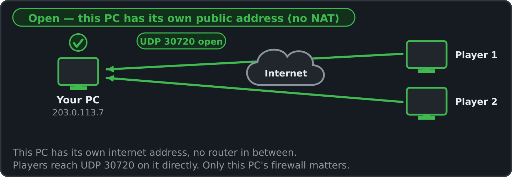
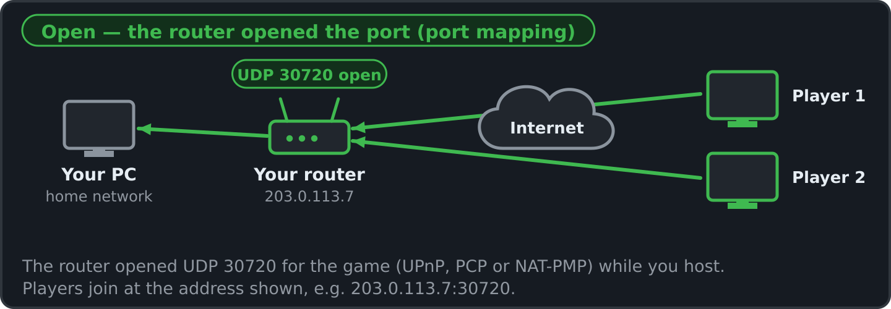
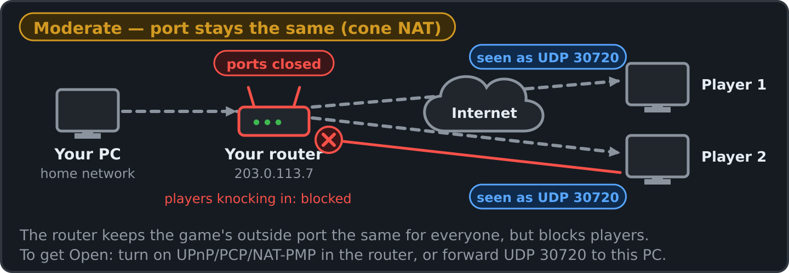
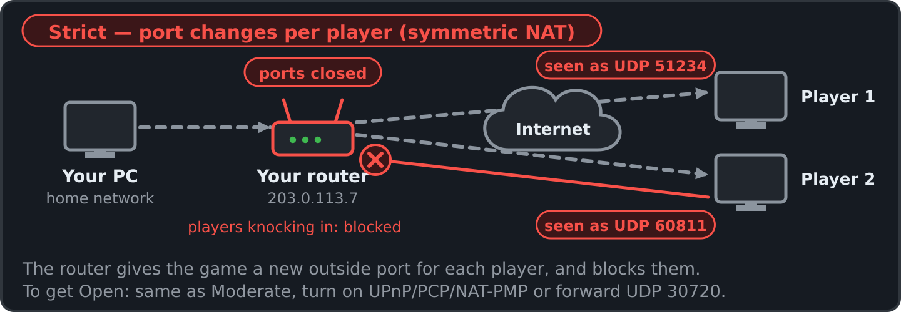
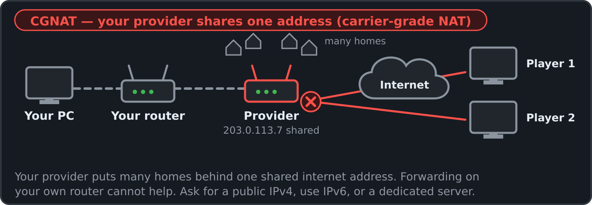
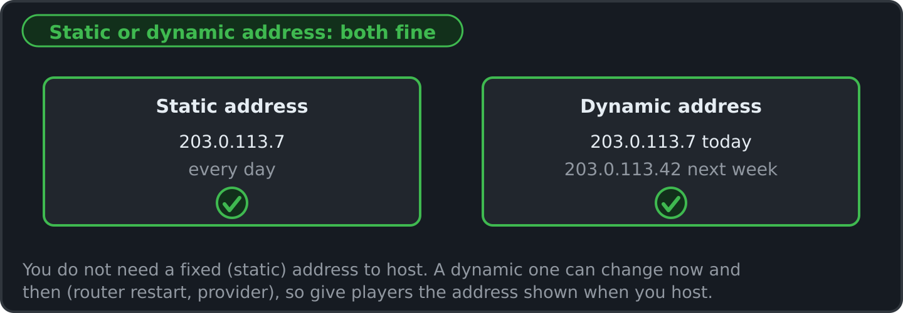
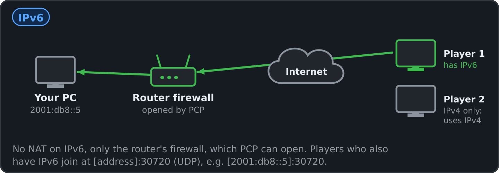
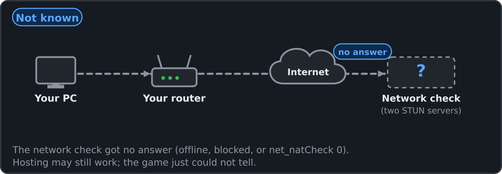

# Tremulous → Godot 4 + Rust (Spreadsheet Method port)

A port of [tremulous-legacy](https://github.com/darklegion/tremulous-legacy)
(pinned at `c862a534`) to **Godot 4.7** with all gameplay in **Rust**, built
the way `THE-SPREADSHEET-METHOD.json` / `Rust Spreadsheet Game Workflow.txt`
prescribe: the TSV sheet book is the source of truth, a preflight gates every
build, generated code never touches the source tree, and the movement and
collision code is held bit-exact to the original C by golden traces.


```
sheets/           the book: doctrine, schema, enums, plan/impl, kernel allowlist,
                  decisions, work/tokens ledgers, 18 domain sheets, symbol map
crates/sheetty    preflight L0–L7 + emitter (tables, consts, enums, PHF registry,
                  fn tables, path checks)      crates/sheetty-cli: the CLI
crates/trem_sim   engine-agnostic simulation: generated tables + 42 kernels
crates/trem_godot GDExtension: TremGame node (input, fixed tick, rendering, BSP view),
                  TremHud (original menu-script HUD), cgame particles/trails/marks
godot/            Godot project (main.tscn, hud.gd, tests/*.tscn, bin/ libraries)
re/               original source, C reference harness, golden traces, evidence
```

## Play

**Just play (Windows x64):** download `Tremulous-Revamped-win64.zip` from
[Tremulous-Revamped-Release](https://github.com/MeepingsCorner/Tremulous-Revamped-Release/releases/latest),
unzip it anywhere and run `Tremulous.exe`. For the 4K textures, also unzip
both `tremulous-revamped-hd-textures-part*.zip` files into the same folder,
so an `hd` folder sits next to `Tremulous.exe`.

**From source:**

1. Install Godot **4.7** (standard build).
2. Open `godot/project.godot` and press Play (F5). Prebuilt libraries are in
   `godot/bin/` for Linux x86_64 (`libtrem_godot.so`) and Windows x86_64
   (`trem_godot.dll`, plus the FMOD / Steam Audio runtime DLLs). On macOS,
   build the library yourself (see Build).
3. The original start sequence runs: the `splash.RoQ` intro (any key skips
   it), then the main menu of `ui/main.menu` with its splash model and
   heartbeat loop. Play opens the server browser (LAN, Internet, Favorites;
   dec035, dec042). Its Create Server starts a listen server on a map that
   other players can join, with the chosen number of bots per team (3 by
   default). Options edits the engine cvars (video mode, brightness,
   volumes, server protocol, voice chat, ... kept in `autogen.cfg`); Leave
   in the in-game menu comes back here. `-- +map atcs` on the command line
   starts a single-process game on a map directly (3 bots per side).
4. Choose a team, then a spawn item or class.

**Controls** are the original's: the bind table of the game data's
`default.cfg` (a built-in copy when there is no game data), then the port's
own additions (`port_default.cfg`, on keys `default.cfg` leaves free), then
`user://autogen.cfg` (written whenever a bind or archived cvar changes) and
`user://autoexec.cfg`. The Controls tab of Esc → Options rebinds keys.

* Original keys: WASD/arrows move · Space jump · C crouch · Shift walk ·
  Mouse1/Ctrl fire · Mouse2 alt-fire · Q use structure / evolve · `[` `]` /
  wheel select item, Enter / Mouse3 use it · R reload · B buy ammo ·
  M medkit · E deconstruct · F gesture · T/Y chat · Tab scores · F1/F2 vote
  yes/no · Esc menu · `~` console.
* Port additions: X sprint · Z dodge (legacy's defaults for the 1.1 keys) ·
  V third person · K voice chat microphone on/off (dec052) · G flashlight
  (humans) / night vision (aliens), enhanced graphics only · F3/F4 add an
  alien/human bot · F5/F6 remove one · F7 restart · F8 map menu · F9 help ·
  F10 graphics mode (classic ↔ enhanced).
* The console is the original drop-down one: scrollback (PgUp/PgDn), edit
  line, history (Up/Down, kept in `user://q3history`) and Tab completion of
  commands, cvars, keys and cfg files; `/bind`, `/bindlist`, `/exec`, cvars,
  `/callvote map nexus6`, `/give all` with cheats… Text without a slash is
  chat in a game, as in the original. `name` (or Options → player name) is
  your name. The cgame's `testmodel`, `testgun`, `testPS`, `testTS`,
  `cg_drawBBOX` and `cg_drawSurfNormal` debugging tools work.
* A gamepad works like the original's SDL joystick after
  `seta in_joystick 1; in_restart`: buttons and the d-pad are JOY1…32 keys
  to `bind` (default.cfg binds none), `in_joystickUseAnalog 1` drives the
  `j_*` analog movement cvars, and the pad also drives the menus and the
  console (dec037).

**Original Tremulous content is included.** `godot/base/` holds the
unmodified Tremulous 1.1.0 pk3s (game data + the 8 official maps), CC BY-SA
2.5 — see `godot/base/COPYING`, `CC` and `README.txt` (dec016). A game on
e.g. **ATCS** uses the original:

* MD3 models with their skins — human base/light armour/helmet/battlesuit,
  all alien classes, every buildable, weapons and the first-person hands;
* animations driven by each model's `animation.cfg` (legs/torso/gestures for
  humans, non-segmented alien animations, buildable construct/idle/attack/
  pain/destroy), interpolated per frame on the GPU (vertex-animation
  textures);
* sounds — weapon fire/impacts and looping weapon sounds, footsteps, jumps,
  falls, pain/death, buildable loops and events, stage announcements;
* maps drawn stage by stage from their shader scripts (every stage's blend,
  rgbGen / alphaGen waves, tcGen / tcMods, animMap, deformVertexes and
  polygonOffset decals; dec043), skies with their cloud layers, fog
  volumes, lightmaps and light-grid lighting for models, curved-patch
  collision, doors/lifts/trains/buttons and every trigger, target and misc
  entity of the 8 maps;
* the cgame effects: every particle system and trail of `scripts/*.particle`
  and `*.trail` (impacts, muzzles, missiles, blood, explosions and gibs,
  jetpack, acid tubes, tesla and lev2 zap beams, map particle systems),
  impact marks, alien creep and blob shadows (mark polys clipped to the
  map's surfaces like the original's R_MarkFragments, dec030), and the
  original HUD from `ui/tremulous_*_hud.menu` with its ring/arm art, number
  font, scanner and alien sense.

**Graphics modes** (F10, `r_enhanced`, console `port_gfx
vanilla|enhanced|rt|pt|auto|off|info`): classic draws the game as the
original does. Enhanced adds PBR lighting, the 4K texture pack and HD
interface art (when the `hd` folder is present), HD sounds, FMOD + Steam
Audio sound (Windows), ray-traced ambient occlusion / indirect light /
reflections, ragdolls, the flashlight / night vision and world-fixed dynamic
shadows (dec044).

F8 opens the map menu. More pk3s can go in `user://base`, `base/` next to the
executable, or `--base=DIR`. Without any data pk3 the game falls back to the
sheet-authored arena with primitive models.

## Multiplayer (dec033 .. dec047, dec052 .. dec054, dec056)

The client and server speak the original protocol 71 (Huffman, msg deltas,
netchan bit-exact against the C) and vanilla 1.1.0's protocol 69, with a
server over the World and a client/cgame that renders from snapshots with
prediction. `+map` without networking still runs the whole game in one
process; Create Server and `net_enabled 1` start a network server.

* **Host a listen server**: Play → Create Server, or
  `-- +set net_enabled 1 +map atcs` (console: `set net_enabled 1`, then
  `map atcs`). It listens on UDP `net_port` (30720, or the next free of
  ten). `sv_hostname`, `sv_maxclients`, `rconPassword`, `g_password` apply.
  The host's own player joins over the loopback and is the top admin;
  remote players identify by `cl_guid`.
* **Host for the internet**: Create Server → Dedicated: Internet
  (`dedicated 2`): you keep playing on it as a listen server, and it
  announces itself to the masters (`sv_master1..5`) every 5 minutes. The
  server asks the router to forward its port by PCP, NAT-PMP and UPnP at
  once (dec046, dec076; `net_upnp 0` turns all three off) and prints the
  address internet players join at. If the router does none of them,
  forward UDP 30720 to the hosting PC yourself.
* **Join**: the server browser (LAN / Internet / Favorites, pinged), or the
  console `connect 192.168.1.10[:30720]`, `reconnect`, `disconnect`;
  `localservers`, `globalservers 0 full empty`, `ping`, `serverstatus`,
  `rcon <cmd>` (with `rconPassword`), `heartbeat`, `serverinfo`,
  `systeminfo`, `killserver`. `cl_guid` is the MD5 of `user://qkey`
  (generated once).
* **Internet server list** (dec039, dec040): the Internet tab lists
  master.tremulous.net's servers. That master reads the first word after
  `getservers` as the protocol (the C's game-name request got an empty
  list), so the client asks it for 71 and for 69 and merges the answers.
  GPP / 1.2 servers (protocol 70) are not listed. Mod servers on protocol
  71 are listed but run game code the port does not have.
* **LAN** (dec045): Play → LAN finds servers on the same network by
  broadcast, on every network adapter's own broadcast address too. LAN
  games need no router forwarding, and the host's console prints the
  address friends can also join directly (`connect 192.168.x.y:30720`).
* **Windows Firewall** (dec047, dec054, dec076): other PCs only reach a
  hosted game if the router lets players on the internet in (port opening:
  PCP, NAT-PMP or UPnP; with IPv6, PCP opens the router's IPv6 firewall)
  and Windows lets the game in (needed by every player). When you start a
  network game the console prints one status, in that order, and a Windows
  dialog shows it too, each time you host; if this PC's firewall keeps
  players out it asks: Allow players
  to join (one inbound UDP rule "Tremulous Revamped" for the exe, after the
  UAC prompt; a block rule Windows made for the game, and the game's own
  rules for copies that no longer exist, go in the same step), Host for my
  home network only (LAN) (the rule "Tremulous Revamped (LAN)", local
  subnet only; the router port is closed again), Host anyway, and a "Don't
  ask again when I host" checkbox (`net_hostWindow 0`). Joining and the
  LAN list normally need no rule. `firewall_allow` (or `firewall_allow lan`)
  asks again at any time; `hosting_status` checks the router, the network
  and the firewall again while you host and shows the dialog even after
  "Don't ask again" (untick the box there, or `net_hostWindow 1`, to
  have it back each time), and also writes what it found, and why a window
  did or did not open, to `hosting_status.txt` in the game's user folder
  (the console prints the path). The window never waits for Windows: if
  the firewall check has not answered after 8 seconds it opens with that
  row marked "still checking" and updates when the check ends; a window
  that is skipped or cannot be shown says why in the console. The status also says what kind of network it is,
  from two STUN requests sent from the game's port when you host
  (`net_stunServers`, `net_natCheck 0` turns it off), and the IPv6 join
  address when the PC has one: see
  [Hosting and your network](#hosting-and-your-network).
* **Check from a terminal**:
  `cargo run --release -p trem_sim --example server_list -- lan` or
  `-- master` (both print each server's ping, players, map and name).
* **Vanilla 1.1.0 servers** (dec040, dec041): Options → Server Protocol:
  Auto (default: asks the server and uses its protocol), 1.3 (71) or
  1.1 (69); the console takes `connect host -69` / `-71` (`-1` as in
  GrangerHub's client). The browser's Game Type column says "base 1.1" or
  "base 1.3", Version filters All / 1.3 / 1.1, and each server is joined
  with its own protocol. On a 1.1 server the 1.1 game is used: its weapons,
  classes, buildables (the hovel, the advanced construction kit), prices,
  HUD values and its own movement for prediction (byte-exact against
  1.1.0's bg_pmove.c). A pure 1.1 server (`sv_pure 1`) also wants its
  vms-1.1.0.pk3: with `sv_allowDownload 1` the client fetches it, else put
  it in the base folder.
* **Dedicated server**: headless Godot,
  `godot --headless --path godot -- +set dedicated 1 +map atcs`
  (`dedicated 2` also announces to the masters; no rendering, menus or
  audio; stdin is the server console; `--base=DIR` adds a pk3 folder), or
  without Godot:
  `cargo run --release -p trem_sim --example dedicated -- +set sv_hostname "My server" +set rconPassword secret +map atcs`
  (stdin is the server console; maps come from `godot/base` or
  `--base=DIR`; admin.dat, layouts and games.log go to `fs_homepath`,
  default `./dedicated-home`).
* **Server administration** (dec026, dec031, dec034): the shrubbot admin
  system (admin.dat in `user://`; admin commands as client commands —
  `/kick Xeno1`, `/adminhelp` — or `!kick` in chat; bans match GUIDs,
  pseudo-GUIDs for the host and bots, and IP/CIDR addresses), the
  kick/mute/denybuild/allowbuild votes, server console commands (`status`,
  `forceteam`, `layoutsave`, `eject`, ...), buildable layouts
  (`layouts/<map>/<name>.dat` from the pk3s and `user://layouts`,
  g_layouts, rotation `layouts`), the build log with `revert`, name
  cleaning, flood and censor limits, g_inactivity, session data across map
  changes, unlagged hit detection, the lag check, and the server log
  (`user://games.log`, g_logFile / g_logFileSync, every G_LogPrintf line of
  the C).
* **Pure servers and downloads** (dec037): servers run `sv_pure 1` like the
  original (clients must use the server's pk3s; the pk3 checksums are the
  original's, checked against its files.c / md4.c), and
  `sv_allowDownload 1` lets clients fetch the referenced pk3s they lack
  (over UDP). The client asks first (the original download popup) unless
  `cl_allowDownload 1`; downloads land in `user://base` and are used at
  once. `fs_openedList` / `fs_referencedList`.
* **Demos** (dec037): `record [name]`, `stoprecord`, `demo <name>` (also the
  Demos menu), `timedemo 1`, `cl_autoRecordDemo 1`; files are
  `user://demos/<name>.dm_71` in the original format. Recording a
  single-process game restarts its map on a local loopback server, as the
  original always plays.
* **IPv6** (dec037): `net_enabled` bits as in the original (1 ipv4, 2 ipv6,
  4 prefer ipv6, 8 no multicast; the port's 0 means single process and
  opens both families for a client), `connect -6 [::1]:30720`, `net_ip6`,
  `net_port6`, and the LAN scan through the `net_mcast6addr` multicast
  group.
* **Voice chat (VoIP)** (dec038, dec052, dec053, dec056): ioquake3's Opus
  voice chat, interoperable with original clients and servers (the bundled
  libopus 1.1 of `re/source`, built by `crates/trem_opus`). K toggles the
  microphone (`voip_toggle`); it turns itself off and says why when the
  server has no voice chat. A voice HUD at the left shows MIC ON / TALKING
  with the level, MIC OFF, and who is talking (`cl_voipHud`). Options →
  Sound → Voice Chat... picks the microphone (`s_voipInputDevice`) and sets
  voice chat on/off, mic volume, game sound while talking, voice activation
  and the HUD. Push-to-talk: `bind <key> +voiprecord` (or `cl_voipUseVAD 1`
  for voice activation). `cl_voipSendTarget` is `spatial` (heard at your
  position), `all`, `attacker`, `crosshair` or client numbers;
  `voip ignore|unignore <n>`, `voip gain <n> [value]`,
  `voip muteall|unmuteall`; `cl_voip 0` turns it off, `cl_voipShowMeter`
  the `VoIP: [****]` meter, `cl_voipGainDuringCapture` /
  `cl_voipCaptureMult` as in the C. Servers relay with `sv_voip 1`
  (default). Needs `rate` >= 25000 and a microphone (Godot's audio input,
  enabled in project.godot).
* **Video capture** (dec037): `video [name]` / `stopvideo` write
  `videos/<name>.avi` in the user folder (motion JPEG with
  `cl_aviMotionJpeg 1`, else raw BGR; the game's mixed sound as PCM) at a
  fixed `cl_aviFrameRate` (default 25) — like the original, `video` runs
  while a demo plays.
* **Headless client / interop probe**:
  `cargo run --release -p trem_sim --example net_probe -- 127.0.0.1:30720 20`
  joins any protocol 71 server (an original legacy `tremded` too), walks,
  fires and prints what it sees. The port's client joins an original
  tremulous-legacy `tremded` (built from `re/source`) and plays (team,
  spawn, move, fire, clean disconnect).

## Hosting and your network

When you host, the game asks your router to open the game's port (PCP,
NAT-PMP or UPnP: automatic port opening) and asks two public STUN servers
what the game's address looks like from the internet (and the first one
once more from a separate socket, like this PC's other traffic). The host status
(console, and the Windows dialog when this PC's firewall keeps players out)
then shows the steps in the order a player's packet passes them: **Router**,
then **This PC's firewall**, each with its state, the join addresses (every
port is UDP) and **Network type**, one of the types below. "What does this
mean?" in the dialog opens this section.

| Network type | Players on the internet can join? | What to do |
|---|---|---|
| Open — this PC has its own public address (no NAT) | Yes | Nothing. Only this PC's firewall matters. |
| Open — the router opened the port (port mapping) | Yes | Nothing. The router opened UDP 30720 while you host. |
| Moderate — port stays the same (cone NAT) | Not yet | Turn on UPnP (or PCP / NAT-PMP) in the router, or forward UDP 30720 to this PC. |
| Strict — port changes per player (symmetric NAT) | Not yet | The same as Moderate. |
| CGNAT — your provider shares one address (carrier-grade NAT) | No | Ask your provider for a public IPv4 address, use IPv6, or play on a dedicated server. |
| Not known | Maybe | The check got no answer. Hosting may still work. |
| Unclear — two internet connections, rare (multi-WAN / policy routing) | Maybe | Give players the game's address shown. |

The network type describes the router side only. Players on your own
network (LAN) need just this PC's firewall.

### Open — this PC has its own public address (no NAT)



This PC has its own public internet address and no router in between.
Players join at the address shown. Only this PC's firewall matters.

### Open — the router opened the port (port mapping)



Your router opened UDP 30720 for the game when you started hosting and
closes it when you stop. Players join at the address shown.

### Moderate — port stays the same (cone NAT)



Your router did not open the port, but it keeps the game's port the same
for everyone it talks to. Players cannot get in yet.

**To get Open:** turn on UPnP (or PCP / NAT-PMP) in your router, and the
game opens UDP 30720 itself the next time you host; or forward UDP 30720 to
this PC by hand ([how to forward a port](https://portforward.com)). The game
can see the first, not the second: after a manual forward the status still
says Moderate and "no answer", but players can join.

### Strict — port changes per player (symmetric NAT)



Your router gives the game a different port for each place it talks to
(common on office, school and mobile networks). Players cannot get in yet.

**To get Open:** the same as Moderate. Turning on "static port" in the
router as well makes it Moderate; that only matters for future features
that connect without forwarding. Network people call these two **cone NAT**
(Moderate) and **symmetric NAT** (Strict), see
[RFC 4787](https://www.rfc-editor.org/rfc/rfc4787) (endpoint-independent
and address-and-port-dependent mapping).

### CGNAT — your provider shares one address (carrier-grade NAT)



Your provider puts many homes behind one internet address
([carrier-grade NAT](https://en.wikipedia.org/wiki/Carrier-grade_NAT)).
Port forwarding on your own router cannot help.

**To get Open:** ask your provider for a public IPv4 address (often free or
cheap), use IPv6 if you have it, or play on a dedicated server.

### Unclear — two internet connections, rare (multi-WAN / policy routing)

The game's internet address is not the one this PC's other traffic uses,
or the router opened the port on another internet address than the one the
game's traffic leaves from: the router has two internet connections. Players
join at the address the host status shows (it names both): the router's
when it opened the port, else the game's. Nothing is wrong with your
network, and it is not CGNAT: both addresses are public.

### Static or dynamic address: both work



You do not need a static (fixed) public address to host. A dynamic one can
change now and then (after a router restart or when the provider renews
it), so give players the address shown when you host.

### IPv6



If you have IPv6, players who also have IPv6 can join at the `[address]:30720`
(UDP) shown. There is no NAT on IPv6, only the router's firewall, which PCP
can open.

### Not known



The check got no answer (offline, blocked, or `net_natCheck 0`).

### This PC's firewall (Windows)

Windows lets other PCs reach the game only with an inbound rule. The dialog
offers **Allow players to join** (one rule, "Tremulous Revamped", for this
exe; Windows asks for permission), **Host for my home network only (LAN)**
(the rule "Tremulous Revamped (LAN)", local subnet only, and the router port
is closed again) and **Host anyway** (nobody else can join until the
firewall is open). `firewall_allow` in the console does the same later. If
you forward UDP 30720 by hand, forward it to this PC's LAN address, shown as
`LAN (UDP)` in the status.

### How it was checked

The game sent two small STUN requests from its own port
(stun.cloudflare.com, stun.l.google.com; change them with `net_stunServers`,
turn the check off with `net_natCheck 0`). Nothing else is sent.

### More

- [How to forward a port](https://portforward.com)
- [How NAT traversal works (Tailscale)](https://tailscale.com/blog/how-nat-traversal-works)
- [Carrier-grade NAT (Wikipedia)](https://en.wikipedia.org/wiki/Carrier-grade_NAT)
- [The terms: cone, symmetric (RFC 4787)](https://www.rfc-editor.org/rfc/rfc4787)

## Build

```sh
cargo build --release -p trem_godot                       # runs preflight first (D5)
cp target/release/libtrem_godot.so godot/bin/             # macOS: .dylib, Windows: .dll
# Windows from Linux:
CARGO_TARGET_X86_64_PC_WINDOWS_GNU_LINKER=x86_64-w64-mingw32-gcc \
  cargo build --release -p trem_godot --target x86_64-pc-windows-gnu
```

On Windows, build the DLLs that get committed to `godot/bin/` with
`powershell -ExecutionPolicy Bypass -File tools\build_release.ps1`. It
passes `--remap-path-prefix` for the Cargo home and the repo (stable Cargo
has no `trim-paths` yet), so panic locations name `/cargo/...` and
`/src/...` instead of folders under your user profile, builds into
`target/dist`, and copies `trem_godot.dll` and `trem_audio.dll` to
`godot/bin/`. `trem_audio.dll` (the FMOD + Steam Audio sound path,
`crates/trem_godot/native/trem_audio.c`) is built by `build.rs` on Windows
with MSVC from the SDK files in `third_party/fmod` and
`third_party/steamaudio`; other builds keep Godot's audio.

The 4K texture pack is too big for the repo: download both zips from the
[4K texture pack release](https://github.com/MeepingsCorner/Tremulous-Revamped/releases/tag/hd-textures-v1)
and unzip them into one `hd` folder, next to the game's executable or in the
game's user folder
(`%APPDATA%\Godot\app_userdata\Tremulous (Godot + Rust port)\hd`). The pack
is stored losslessly compressed (dec055, `crates/trem_hdpack`): each mip
level is zstd-compressed and identical textures are links, so the GPU gets
exactly the same data. Shrink a pack built before that (or check one) with:

```sh
cargo run --release -p trem_hdpack --bin hdpack -- stat <hd folder>
cargo run --release -p trem_hdpack --bin hdpack -- pack <hd folder>
```

`godot-mcp.config.json` is an MCP server entry for `@coding-solo/godot-mcp`.
Its `GODOT_PATH` uses `${USERPROFILE}`, which Claude Code expands in MCP
configs; a client that does not expand variables needs the full path to the
Godot executable there instead.

## Verify

```sh
cargo run -p sheetty-cli -- preflight        # PASSED 0 error(s), 0 warning(s) (L0..L8)
cargo run -p sheetty-cli -- matrix           # checkmark matrix: every row x column checked (L8)
cargo run -p sheetty-cli -- json [group]     # the sheet book as grouped JSON (00-groups.tsv)
TREM_DATA=<unpacked data-1.1.0> cargo test --workspace   # parity, BSP, patches, movers, game rules, net, fx, hud
make -C re/harness pmove_ref && re/harness/pmove_ref sheets arena | sha256sum   # = re/traces/arena.sha256
make -C re/harness curve_ref && re/harness/curve_ref atcs.bsp | sha256sum        # = re/traces/curve/atcs.sha256
godot --headless --path godot --import   # the first headless import of any godot-rust class can abort
godot --headless --path godot --import   #   at exit (upstream; the editor GUI is fine): run it twice
godot --headless --path godot res://tests/smoke.tscn                        # joins, spawns, plays, PASS
xvfb-run godot --rendering-driver opengl3 --path godot res://tests/bsp_shot.tscn  # pk3 → BSP → render, PASS
cargo run -p trem_sim --example match_sim -- 120 3                           # headless bot match
make -C re/harness net_ref && re/harness/net_ref | sha256sum   # = re/traces/net.sha256 (tests/net.rs checks the port)
make -C re/harness pak_ref && re/harness/pak_ref godot/base/data-1.1.0.pk3 | sha256sum   # = re/traces/pak.sha256 (tests/pure.rs)
cargo test -p trem_sim --test net_files --test net_demo --test net_ipv6   # downloads + pure, demo record/replay, ipv6
godot --headless --path godot -- --base=DIR +set dedicated 1 +set sv_allowDownload 1 +set net_port 30770 +map dltest &   # DIR holds a map pk3 the client lacks
xvfb-run -a godot --rendering-driver opengl3 --path godot res://tests/a_dl_shot.tscn -- --port=30770 [--prompt]   # downloads it, plays
xvfb-run -a godot --rendering-driver opengl3 --path godot res://tests/a_demo_shot.tscn   # records single player, plays the demo
cargo test -p trem_sim --release --test net_session   # server + clients over UDP: join, move, see, shoot, lag + unlagged
xvfb-run -a godot --rendering-driver opengl3 --path godot res://tests/net_shot.tscn -- --role=server --port=30760 &
xvfb-run -a godot --rendering-driver opengl3 --path godot res://tests/net_shot.tscn -- --role=client --port=30760
TREM_SEEDS=0,1,2,3,4,5 cargo run --release -p trem_sim --example match_sim -- 600 3 atcs tremor   # balance summary
xvfb-run godot --rendering-driver opengl3 --path godot res://tests/misc_shot.tscn  # warmup, console, testmodel, patch marks
```

What the evidence covers:

| Layer | Evidence | Strength |
|---|---|---|
| Pmove, slidemove, cm_trace (AABB) | 20 scenarios × every tick, 93,699 cells, float bits compared against the original C compiled natively | bit-exact (Verified) |
| 1.1.0 movement (protocol 69 prediction) | the port's 1.1 pmove against 1.1.0's bg_pmove.c compiled natively (dec041) | byte-exact (Verified) |
| Constants/tables | L5: sheet cells compared with values extracted from the original program | exact |
| IBSP loader | arena → IBSP → parse round-trip; 3,000 random traces identical to the sheet clip map; golden trace replayed on the BSP-loaded map | exact |
| Patches, inline models, PVS/areas | 30,000 random box/point traces per map on the 8 official maps, hashed against the original cm_*.c compiled as `re/harness/cm_ref` | bit-exact (Verified) |
| Patch grids (tr_curve.c) | `R_SubdividePatchToGrid` for every patch of the 8 maps (sizes, positions, normals) hashed against the original tr_curve.c compiled as `re/harness/curve_ref` | bit-exact (Verified) |
| Game rules (g_*.c) | behavioural tests: spawn queues, buy/sell, evolve, build, decon marking, BP zones, rifle kill + credits, doors/triggers/pendulums on the real maps, door area portals, follow, intermission, votes, client-command gating, chat, deterministic bot match; `tests/server.rs`: layouts, build log/revert, admin permissions and commands, server console, name cleaning, inactivity, sessions | behavioural (dec014) |
| Effects/HUD (cgame) | every stock particle/trail script parses; emission/expiry/attachment tests; HUD menus parse; screenshots (`tests/fx_shot`, `hud_shot`, `play_shot`) | smoke |
| Networking (huffman.c, msg.c, net_chan.c) | `re/harness/net_ref.c` runs the original files on a seeded stream of bits, strings, usercmd/entity/playerstate deltas, Huffman and fragmented netchan packets; the port's bytes hash the same (`re/traces/net.sha256`) | bit-exact (Verified) |
| Pak checksums (files.c, md4.c) | `re/harness/pak_ref.c` runs the original unzip.c + md4.c with FS_LoadZipFile's checksum loop on data-1.1.0.pk3 (checksum and pure checksums for 8 feeds, md4 vectors); the port prints the same (`re/traces/pak.sha256`) | bit-exact (Verified) |
| Pure / downloads / demos / ipv6 | `tests/net_files.rs`: a client downloads a missing map pk3 in 1024-byte blocks into its home, restarts its search path and passes SV_VerifyPaks_f, the download prompt, refusals (sv_allowDownload 0, unreferenced paks, a forged cp); `tests/net_demo.rs`: a recorded session replays every snapshot identically, timedemo; `tests/net_ipv6.rs`: ipv6 parsing/printing/masks (socket tests skip without ipv6); Godot: a headless dedicated server feeds a Godot client a map it lacks (`tests/a_dl_shot`), single player recorded and played back (`tests/a_demo_shot`) | behavioural |
| Server / client / cgame | `tests/net_session.rs`: two clients over localhost UDP join, move (prediction agrees with the server), see each other, one shoots the other, clean disconnect; 224 ms lag: prediction within tolerance and unlagged hits; listen server + LAN scan + pings + join; GUID/ban refusals, rcon, getinfo/getstatus; two Godot instances (`tests/net_shot`) see and shoot each other; the port's client against an original tremded | behavioural |
| Godot front end | headless smoke run + rendered screenshots | smoke |

## How the Method maps onto this repo

* **D1/D2 one source of truth** — every number the rules read is a sheet
  cell (`sheets/domain/*.tsv`), seeded by `re/harness/extract.c` and
  `gen_consts.py` from the original program, never retyped.
* **D3 one module per sheet**, **D6 generated code only in OUT_DIR** —
  `trem_sim/build.rs` runs `sheetty::run`; `sheetty check-generated` proves
  nothing generated is committed.
* **D4 kernel allowlist** — every file in `trem_sim/src/kernel/` has a row
  in `sheets/kernel.tsv`; an unlisted file fails L0.
* **D5 preflight gates the build** — L0 structure, L1 types, L2 refs, L3
  plan/impl coverage + symbol map, L4 assets, L5 divergence vs the
  original, L6 budget, L7 determinism, L8 completeness (every row × column
  checked).
* **Dispatch as data** — `weapon_behaviors`, `buildable_behaviors` and
  `systems` are fn tables; `systems` is emitted in topological order of its
  `after` column.
* **Mode A** — `re/source` (original), `re/harness` (oracle),
  `sheets/re/symbols.tsv` (every original function with its status),
  `re/harness/statuses.py` recomputes it.
* **Decisions** — `sheets/decisions.tsv` dec001–dec056 (Godot instead of
  Bevy, bundled CC BY-SA media, deterministic RNG, behavioural verification
  of g_*.c, bots, networking, protocol 69, the enhanced mode, voice chat,
  firewall and UPnP, …).

## Known gaps (honest list)

* **Networking**
  * GPP / 1.2 servers (protocol 70) are not supported or listed, and demos
    of 1.1 games do not play.
  * Mod servers on protocol 71 are listed but run game code the port does
    not have.
  * Downloads are UDP only (no cURL).
  * An original client joining the port's server is untested; the
    server's packets come from the same verified msg/netchan code.
  * UPnP, PCP and NAT-PMP are tested against fake routers only, and the
    network check against fake STUN servers; LAN play between two PCs is
    verified on one PC only (dec045).
  * Server-side deviations (events as temp entities, the `servermenu`
    notice command, ClientBegin at connect time, sv_fps 60) are listed in
    dec033.
  * Pure checks treat the built-in cgame / ui as coming from the pak with
    their qvm, else the one with ui/hud.txt / ui/menus.txt. The port's own
    server does not need 1.1.0's vms pk3; only joining a pure 1.1 server
    does (dec037, dec041).
  * The ipv6 socket and multicast tests skip on machines without ipv6.
* **Voice commands**: `vsay` is still dropped (dec027): the game data has no
  voice lines. (VoIP voice chat works; see Multiplayer.)
* **Bots** are new (dec015) and simple; on uncreation a bot can still fall
  to its death now and then. Their balance is part of their definition of
  done (dec036): over six seeds per official map no team wins more than two
  thirds of a map's matches; most matches run the full ten minutes and end
  in a draw, and tremor favours the aliens most.
* **Rendering**: marks are meshes, so they draw in the Compatibility
  (OpenGL) renderer too (`tests/marks_shot.tscn`). Curved patches are
  `R_SubdividePatchToGrid` grids for both drawing and mark clipping (no
  patch stitching or distance LOD), and multi-stage mark shaders animate
  their tcMods / `rgbGen wave` (the wake). Particle `realLight`, bounce
  marks/sounds and model-particle animation are not used by the stock
  scripts and are skipped.
* **Platforms**: no prebuilt macOS library; FMOD + Steam Audio sound is
  Windows only (other platforms use Godot's audio).

Other notes:

* The legacy repo's own assets (legacy menus and HUDs, buildable health
  bars, particle/shader overrides) are packed into
  `godot/base/data-legacy-assets.pk3` by `python3 re/harness/pack_assets.py`
  and override data-1.1.0 (dec025).
* Map rotation: `maprotation.cfg` is read from the data folders (a copy of
  the stock `rotation1` ships in `godot/base`); `initial_map_rotation` on
  the TremGame node picks the rotation, and the console takes
  `maprotation NAME`, `advanceMapRotation` and `stopMapRotation` (dec022).
* Light flares default to `cg_lightFlare 3` (bisphere "real" fade, dec024);
  `cg_lightFlare 0..2` in the console switches mode.
